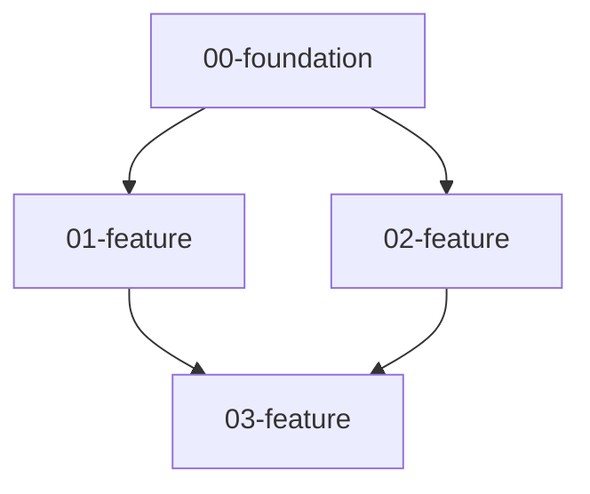

# <Product or feature set> — Overview
Status: draft for approval

## Goals
- G1 <measurable outcome>

## Non-goals
- N1 <explicitly out of scope>

## Roles
| Role | Description | Main capabilities |
|---|---|---|

## Architecture
Stack and versions, the pattern for business logic (service, action or repository), data stores, queues, storage, auth, how the pieces talk. Reference `_recon.md` for an existing app.

## Architecture decisions
### ADR-1 <decision>
- Options: <A>, <B>
- Decision: <chosen>
- Why: <reason and trade-off>

## Features
| # | Folder | Purpose | Depends on |
|---|---|---|---|
| 00 | 00-foundation | Setup, auth and roles, base layer, UI kit, quality pipeline | none |
| 01 | 01-<feature> | <one line> | 00 |

## Dependency graph

## Parallel waves
| Wave | Features | Can start after |
|---|---|---|
| 0 | 00-foundation | approval |
| 1 | 01, 02 | wave 0 merged |
| 2 | 03 | wave 1 merged |

## Shared decisions
Money as integer minor units with a currency column; timestamps in UTC; id type; soft deletes policy; enum storage; naming; audit approach; file storage; queue connection.

## Risks
| Risk | Likelihood | Impact | Mitigation |
|---|---|---|---|

## Assumptions and open questions
| ID | Item | Default if unanswered |
|---|---|---|
